# Architecture

## 1. System context

The system is a single-host academic SOC prototype with four runtime surfaces:

1. **FastAPI service** — ingestion, investigation, approval, execution, metrics and audit.
2. **LangGraph agent workflows** — investigation (phase 1) and response (phase 2).
3. **SQLite database** — events, alerts, incidents, evidence, threat intelligence, MITRE mappings, risk assessments, response actions, approvals, agent runs and the audit chain. Any SQLAlchemy URL can be supplied through `DATABASE_URL`.
4. **Streamlit dashboard** — a thin client over the API for analysts and viewers.

No component requires a cloud service. With no credentials, the LLM runs in deterministic template mode and threat intelligence uses labelled mock/local modes.

```mermaid
flowchart LR
    A[Web logs / alerts / API clients] --> B[Normalization and deduplication]
    B --> C[Rule engine]
    B --> D[Isolation Forest signal]
    C --> E[Alerts]
    D --> E
    E --> F[Incident correlation]
    F --> G[Evidence collection]
    G --> H[Deterministic triage]
    H --> I[Threat intelligence]
    I --> J[MITRE ATT&CK mapping]
    J --> K[Transparent risk score]
    K --> L[Response policy plan]
    L --> M{Approval gate}
    M -->|HIGH / CRITICAL| N[Analyst or admin decision]
    N -->|approve| O[Simulated execution]
    N -->|reject| P[Audited stop]
    M -->|LOW / MEDIUM auto policy| O
    O --> Q[Verification]
    Q --> R[Audit hash chain]
    R --> S[FastAPI / Streamlit]
```



The demo scenario registry in `src/services/demo_scenarios.py` supports `brute_force_account_compromise` (default), `xss_injection`, `unauthorized_access_attempts` and `benign_browsing`. The rendered pipeline diagram used in the paper is `results/figures/pipeline_diagram.png`.

## 2. Ingestion and normalization

`POST /api/events`, `/api/events/batch`, `/api/alerts` and the admin demo endpoint all pass through `SocService.ingest_*`. `scripts/import_logs.py` is a client-side importer for combined-log (`.log`), JSONL and CSV files; it posts through the authenticated API in bounded batches rather than writing SQLite directly.

`src/detection/normalization.py`:

- accepts heterogeneous field aliases (`src_ip`, `remote_addr`, `client_ip`, `url`, `path`, `status`, and others);
- parses Apache/Nginx combined-log lines supplied in `line`;
- normalizes timestamps to UTC and records `timestamp_missing_or_invalid` when receipt time is substituted;
- validates source/destination IPs; invalid values are not promoted to the structured field;
- sanitizes usernames, endpoints, methods, user agents, messages and request bodies;
- redacts secret-like values and truncates large fields;
- computes a SHA-256 deduplication hash over normalized timestamp, source, principal, request and event type;
- counts prompt-injection patterns in untrusted text and preserves them as data;
- stores the bounded original payload in `raw_event` with normalization warnings.

Deduplication is enforced by a unique `dedup_hash`. A duplicate event is audited as `EVENT_DUPLICATE` and can still be attached to an existing correlated incident.

## 3. Detection layer

### 3.1 Signature rules

Rules live in `config/detection_rules.yaml` and are evaluated by `src/detection/rules.py`.

| Rule | Category | Severity | Examples |
|---|---|---|---|
| `SQLI-001` | `sql_injection` | HIGH | `UNION SELECT`, tautologies, time-based functions, `information_schema`, `xp_cmdshell` |
| `XSS-001` | `xss` | HIGH | script tags, event-handler attributes, `javascript:` URLs, DOM sinks |
| `CMDI-001` | `command_injection` | CRITICAL | shell metacharacters followed by OS commands |
| `TRAV-001` | `path_traversal` | HIGH | `../`, encoded traversal, `/etc/passwd`, `win.ini` |
| `RECON-001` | `recon_scanning` | MEDIUM | `/.env`, `/.git/config`, `/wp-admin`, backup files |
| `UA-001` | `suspicious_user_agent` | MEDIUM | sqlmap, nikto, nuclei, nmap, hydra, etc. |
| `PROMPT-001` | `prompt_injection_attempt` | MEDIUM | "ignore previous instructions", "system prompt", "run this command" |

Rules are passive: payloads are never replayed, executed or sent to a target.

### 3.2 Behavioral rules

`AlertDetector` also evaluates event history and configured thresholds:

| Behavior | Default | Alert |
|---|---|---|
| Failed logins for a principal/source on authentication endpoints | 5 in 10 minutes | `brute_force` |
| Successful login after at least 3 failures | 10-minute window | `account_compromise` |
| Request rate | 30 requests / minute | `abnormal_traffic` |
| Server errors | 10 in 5 minutes | `abnormal_traffic` |
| Access-denial burst (`ACCESS-001`) | 3 in 10 minutes | `unauthorized_access` |
| Denial on a privileged endpoint (`ACCESS-002`) | immediate | `unauthorized_access` |
| Known-malicious IP | configured watchlist | `malicious_ip` |

Failed-login and success-after-failure counters are restricted to authentication endpoints, so generic 401/403 access denials do not create brute-force or account-compromise evidence. Alert deduplication uses `dedup_key` so repeated evaluations do not create duplicate alerts.

### 3.3 ML anomaly signal

`src/detection/anomaly_detector.py` loads `models/anomaly_iforest.joblib` if available. The model consumes 14 numeric HTTP features from `src/ml/preprocessing.py`. It contributes an additive `ml_anomaly` alert only when the artifact's threshold is crossed. Deterministic rules remain authoritative; a missing or incompatible artifact is reported as unavailable rather than silently replaced.

## 4. Incident correlation

`src/detection/incident_manager.py` assigns an alert to an open incident if a recent incident shares the source IP or username within the configured correlation window (default 10 minutes). If none exists, a new incident is created.

The incident's initial title, severity and category follow explicit precedence:

- severity uses the maximum observed rank;
- category uses `CATEGORY_PRIORITY` (command injection > account compromise > SQL injection > XSS > traversal > unauthorized access > brute force > malicious IP > abnormal traffic > reconnaissance > scanner UA > prompt injection > ML anomaly);
- nearby events sharing the correlation key are attached so the timeline is not limited to alert-generating events;
- `event_count` is refreshed from stored events.

The initial category is provisional. The investigation agent re-triages after evidence collection and correlation.

## 5. LangGraph workflows

`src/agents/orchestrator.py` defines two compiled `StateGraph` objects.

### Phase 1 — investigation

```text
START
  → evidence_collection
  → alert_triage
  → threat_intelligence
  → mitre_mapping
  → risk_assessment
  → response_planning
  → approval_gate
  → END
```

Each node is wrapped by `_run_stage`, which records an `AgentRun` row (duration, provider, output summary/error) and an audit entry. A failure is recorded and re-raised; it is not swallowed.

| Stage | Provider label | Output |
|---|---|---|
| Evidence collection | `evidence_rules` | Evidence records, correlation summary, prompt-injection flags |
| Alert triage | `investigation_agent` | Classification, confidence, severity, summary, reasoning, next steps, LLM mode |
| Threat intelligence | `threat_intel` | Indicator verdicts and modes |
| MITRE mapping | `mitre_mapper` | Technique mappings with confidence and status |
| Risk assessment | `risk_model` | Score, level, factors and explanation |
| Response planning | `policy_engine` | Allowlisted actions and approval requirement |
| Approval gate | `policy_engine` | `AWAITING_APPROVAL/PENDING` or `APPROVED/NOT_REQUIRED` |

The approval gate writes durable incident state. The graph does **not** wait in memory for a human.

### Phase 2 — response

```text
START → execute → verify → END
```

`execute` is only callable when the incident is `APPROVED` or `CONTAINMENT`. The executor re-checks the allowlist, simulation mode and approval status. `verify` performs six checks and marks the incident `VERIFIED` only when all pass.

## 6. Deterministic triage

`src/investigation/incident_analysis.py` is the authoritative classifier.

- Candidate category is chosen by deterministic precedence over alert types.
- Base confidence comes from a category table (for example, command injection 0.92, account compromise 0.88, SQL injection 0.90).
- Corroboration adds up to 0.06 for multiple alert types plus 0.03 for correlation confidence >= 0.70.
- Confidence is clamped to [0.30, 0.97].
- Severity is the maximum of the category default and alert severities.
- Reasoning includes the formula, event/alert counts, correlation confidence, failed-login count, success-after-failures, alert descriptions and prompt-injection containment.

This design makes the classification reproducible and auditable. It also makes the baseline comparison meaningful: the baseline has no contextual re-triage, while the agentic pipeline does.

## 7. Evidence and timeline

`src/investigation/evidence.py` persists:

- one evidence record per alert, weighted by alert severity;
- recent failed logins;
- suspicious requests with matched rule and field details;
- successful logins, including prior failure count;
- a correlated failure-then-success sequence when detected;
- recent access-denied requests, including endpoint and principal;
- timeline bounds;
- prompt-injection text evidence with a containment note.

Evidence records are deduplicated by type, event and description prefix. The timeline is assembled by `src/investigation/timeline.py` from events, alerts, evidence, agent runs, approvals, response actions and audit entries.

## 8. Threat intelligence

`src/threat_intel/service.py` selects behavior by indicator scope:

| Indicator type | Behavior | Mode label |
|---|---|---|
| Private / loopback / link-local | No external lookup | `NO_EXTERNAL_LOOKUP` |
| Documentation range (RFC 5737) | Deterministic labelled mock | `DEMO_MOCK` |
| Public, live keys configured | Configured providers with cache | `LIVE` |
| Public, no keys | Labelled mock fallback | `DEMO_MOCK` |
| Live providers all fail | Mock fallback with provider errors | `DEMO_MOCK_FALLBACK` |
| Invalid IP | Explicit validation error | `INVALID` |
| Disabled | No query | `DISABLED` |

Every record carries `is_mock`, `mode`, provider and details. Conflicting provider verdicts are surfaced, not averaged away.

## 9. MITRE ATT&CK mapping

`src/mitre/mapper.py` derives behaviors from the classification and alert types, then matches the local catalog `config/mitre_mapping.yaml`.

- Each technique has a base confidence, tactics, rationale and behavior triggers.
- Corroboration adds 0.02 per evidence item, capped at four items.
- Low investigation confidence (< 0.60) caps technique confidence at 0.70.
- A technique is `confirmed` at >= 0.75, otherwise `candidate`.
- Evidence pointers are attached and deduplicated.
- Reputation alone is not mapped; `malicious_ip` scenarios are excluded from MITRE evaluation.
- Volume alone maps only to a weak `T1498` candidate; `abnormal_traffic` is excluded from MITRE evaluation.
- Authorization denial alone is not mapped; `unauthorized_access` is excluded from MITRE evaluation.
- XSS maps to `T1059.007` as a `candidate` at base confidence 0.55, because payload delivery is not proof of execution.

## 10. Risk model

The score is a transparent weighted sum:

```text
score = 100 × Σ (weight_i × normalized_factor_i)
```

| Factor | Weight | Normalization |
|---|---:|---|
| Severity | 0.22 | LOW 0.25, MEDIUM 0.50, HIGH 0.75, CRITICAL 1.00 |
| Investigation confidence | 0.13 | clamp(confidence, 0, 1) |
| Asset criticality | 0.13 | highest matching endpoint prefix (`/admin` 1.00 … `/` 0.40) |
| Threat intelligence | 0.16 | malicious 1.00, suspicious 0.60, unknown/not configured 0.30, clean 0.10, private 0.20 |
| Event volume | 0.08 | event_count / 20, capped at 1 |
| Attack impact | 0.23 | category table (account compromise 1.00 … benign 0.20) |
| Recurrence | 0.05 | prior incidents in 30 days / 5, capped at 1 |

Thresholds: LOW ≤ 24, MEDIUM ≤ 49, HIGH ≤ 74, CRITICAL ≥ 75.

Every factor stores its normalized value, weight, contribution and raw input. The explanation string is stored with the assessment. These weights and thresholds are project-defined engineering parameters, not universal standards. No risk-accuracy claim is made because no ground-truth risk labels exist.

## 11. Response policy and approval

`src/response/planner.py` selects actions by risk level and category from `config/response_rules.yaml`.

| Risk | Auto (recorded/notified) | Approval-gated | Advisory |
|---|---|---|---|
| LOW | `NOTIFY_ANALYST` | — | — |
| MEDIUM | `NOTIFY_ANALYST`, `SIMULATE_NOTIFY_ADMIN` | — | `SIMULATE_BLOCK_IP` |
| HIGH | `NOTIFY_ANALYST`, `SIMULATE_NOTIFY_ADMIN` | `SIMULATE_BLOCK_IP`, `SIMULATE_DISABLE_SESSION` | — |
| CRITICAL | `NOTIFY_ANALYST`, `SIMULATE_NOTIFY_ADMIN` | plus `SIMULATE_RESET_CREDENTIAL`, `SIMULATE_QUARANTINE` | — |

Category additions (for example, `SIMULATE_RESET_CREDENTIAL` for account compromise) are approval-gated at HIGH/CRITICAL and advisory at lower levels.

Approval state machine:

```text
NEW → INVESTIGATING → AWAITING_APPROVAL (PENDING)
                          ├── approve → APPROVED → CONTAINMENT → VERIFIED
                          └── reject  → REJECTED (audited, no execution)
```

The executor refuses if `simulation_mode=false`, the incident is not approved, an approvable action is still pending, or an action is outside the allowlist.

## 12. Audit chain

`src/database/repository.py` appends each audit row with:

```text
entry_hash = SHA256(previous_hash + canonical_json(entry_without_hash))
```

The first entry uses an empty previous hash. `AuditService.verify()` recomputes the chain. Any mutation of a stored row breaks the chain at that row. The chain does not prevent deletion of a suffix; it detects modification or insertion within the remaining chain. It is not a signature or external notarization scheme.

## 13. Data model

| Table | Purpose |
|---|---|
| `users` | Local accounts and roles (`viewer`, `analyst`, `admin`) |
| `security_events` | Normalized events with raw payload, dedup hash and optional incident link |
| `alerts` | Detection output with rule, severity, details and incident link |
| `incidents` | Aggregate state, classification, severity, risk, approval and verification |
| `evidence` | Weighted evidence records linked to events |
| `threat_intelligence` | Per-indicator provider result and mode |
| `mitre_mappings` | Technique, tactics, confidence, status, rationale and evidence |
| `risk_assessments` | Score, level, factors, weights and explanation |
| `response_actions` | Action type, policy mode, approval requirement, status, parameters and result |
| `approvals` | Human decisions with approver, reason and timestamp |
| `audit_logs` | Hash-chained audit trail |
| `agent_runs` | Per-stage duration, provider, summary and error |

SQLite is the default. Tables are created with SQLAlchemy `create_all` at startup. There is no migration framework; this is acceptable for a greenfield academic deployment but should be replaced with Alembic before production use.

## 14. API and dashboard

FastAPI routes are thin wrappers over `SocService`. JWT authentication uses PyJWT with HS256 and a local secret. Passwords use PBKDF2-HMAC-SHA256 with per-password salts. Role dependencies enforce read versus write/approve access.

The Streamlit dashboard calls the API only. It provides:

- login and session handling;
- overview metrics and charts;
- a live-events page backed by `GET /api/events`;
- incident list with severity/status/category filters;
- detail tabs for summary, reasoning, timeline, evidence, threat intelligence, MITRE, risk, response, approvals and audit;
- analyst/admin approval, rejection and execution controls;
- viewer read-only behavior;
- audit-chain verification display.

## 15. Key design decisions

1. **Two-phase graph rather than a long-running human-in-the-loop graph.** Durable database state is simpler to audit and survives process restarts.
2. **Deterministic triage as the authority.** This avoids non-reproducible policy decisions and makes LLM enrichment optional.
3. **Rule + ML hybrid.** Rules provide high-precision signatures; Isolation Forest provides a bounded anomaly signal without overriding rules.
4. **Transparent risk rather than a learned score.** No ground truth exists for risk; a visible weighted model is more defensible.
5. **Simulation-only executor.** The project demonstrates the response workflow without creating real-world safety or legal risk.
6. **Fresh database per evaluation scenario.** Prevents cross-scenario correlation from inflating or deflating results.
7. **Separate ML and scenario evaluations.** Event-level ML metrics and incident-level policy metrics answer different questions; mixing them would obscure what changed.
